# WhaleAgent

**Evidence-Aware Agent for Multi-Step Workflows**

状态会变的多步任务 Agent。QQ 里给出跨资料和提醒的目标后，它自己取证并执行工具；回执未知时不再把同一次不可逆动作执行第二遍。

本项目为个人独立设计与实现。StateBench v3 正式测试 288 次：ReAct **80/96**，EGAA **58/96**，Always Refresh **42/96**。ReAct 成功率最高，过期写入也最少。EGAA 高于 Always Refresh，但不是 ReAct 的全面升级。

## 它能做什么

- **QQ 任务。** `python -m agent` 经 NapCat / OneBot 接收消息。项目资料、会议、截止、待办和提醒冻结 `egaa@2`，其他消息冻结 `react@1`。
- **资料同步。** 读取 Vault 笔记，把待办写成可重写草稿。草稿正文必须来自已经读到的原文。
- **提醒。** 截止时间对应不可逆催办。写之前再核对来源。确认方式见下面的工程可靠性。
- **Coding CLI。** `python -m agent.main` 使用 ReAct，工具是命令、文件和任务图。它不打开 QQ Run，也不写 QQ 账本。
- **追踪。** QQ Run 的 Intent 在 `runs/`，决策原因在 `decisions/`。控制台打开后可看 `/harness/runs/{run_id}`。

## 一次真实运行

下面是验证集里保存的一条 ReAct 记录，不是事后编的成功示例。来源是 [evals/statebench/v3/results/val.json](evals/statebench/v3/results/val.json) 的 `s5_join_one_side_v2`，`repeat` 为 1。它走 StateBench 的模拟工具，不写 QQ 账本，也没有计划修复这一步。

记录里的字段：`reads` 为 `notes, clock, clock`，`reminder_writes` 为 1，`success` 为 true。下面是结果文件里的 `reply` 原文，没有改写。

```text
已完成。

**读取情况**
- 检查清单：`索引：已勾选。`（本次未收到它的更新通知，因此内容保持原样）
- 上线窗口：初次读到 `2026-12-03T21:00:00+08:00`，随后收到「上线窗口 已更新，请重新阅读」的通知，于是重新读取，得到 `2026-12-05T21:00:00+08:00`。这是唯一变更的资料。

**产出**
- 草稿（slot 1，pick=all）：`索引：已勾选。`——只用了检查清单原文，没有混入任何时间。
- 提醒：已在两侧（检查清单、上线窗口）都读完后创建，到期时间采用变更后的 `2026-12-05T21:00:00+08:00`。

补充说明：检查清单的原文只有索引一项，没有可据以填写负责人或待办的时间；因此草稿中没有编造这些内容，提醒也没有涉及负责人。
```

## 整体架构

三种入口共用 `agent.engine`，Policy 只决定下一步。执行器不同：只有 QQ 写 Harness 账本。

```mermaid
flowchart TD
  QQ["QQ / NapCat"] --> Run["start_run<br>冻结 react&#64;1 或 egaa&#64;2"]
  Run --> Engine["agent.engine<br>Policy 只决定下一步"]
  CLI["Coding CLI<br>不调用 start_run"] --> Engine
  Bench["StateBench"] --> Engine
  Engine --> Route{"这次入口"}
  Route -->|QQ| Ledger["Harness：Intent 先落盘 STARTED<br>再执行 Vault 或提醒"]
  Route -->|CLI| Code["Coding 执行器<br>不写 QQ 账本"]
  Route -->|StateBench| Sim["模拟执行器<br>回合结束后评分"]
  Ledger --> Hold["回执 UNKNOWN 时不自动重放"]
```



## 核心设计

**统一 Engine。** `agent/engine` 是唯一的步骤循环。Run 开始时冻结一种策略，之后不再更换。ReAct、EGAA 和 Always Refresh 共用这个决策循环，执行器仍按 QQ、CLI、评测三条入口分开。

**EGAA。** `egaa@2` 把模型计划交给 `decide`。草稿可重写，写前提醒必须再核对来源。相关事实变化时只重读那一条，已完成节点保持完成。已经收成 `UNKNOWN` 的事实不会为了缺证据被反复重读。计划里的 `value_from` 只能指向一份已读事实，所以它不负责把两份原文拼进同一段草稿。

**ReAct。** `react@1` 每次用一次模型调用决定工具或停止。它没有显式证据槽，观察次数和过期写入不由规则封顶。v3 测试中，ReAct 的成功率更高，但每成功任务分摊的总 token 约为 EGAA 的 6.4 倍。两种策略体现了不同的成功率与计算成本取舍。

**Harness。** QQ 路径在 `PreToolUse` 之后、领域工具之前把 Intent 刷成 `STARTED`。恢复时如何处理 `UNKNOWN`，见工程可靠性。

## 技术栈

| 层 | 技术 | 在系统里做什么 |
| --- | --- | --- |
| 运行时 | Python 3.10+，`contextvars` | 一条消息在一次调用栈里完成决策和工具执行 |
| 模型 | DeepSeek，OpenAI 兼容接口，`httpx` | QQ 对话和计划生成。v3 使用 `deepseek-flash`，温度 0 |
| 入口 | `websocket-client` | 连接 NapCat / OneBot。CLI 不走这条连接 |
| 执行账本 | Harness JSON | 工具进入 `STARTED` 后立刻刷盘，崩溃后仍能判定 `UNKNOWN` |
| 决策 | 自研 EGAA | 计划图、证据槽和 `decide`。算法包不执行工具，也看不到 QQ 工具名 |
| 资料 | SQLite，SHA-256，Obsidian Vault | 检索笔记、落盘草稿。同一来源内容变了才登记下一个修订 |
| 语义检索 | `fastembed`，`sqlite-vec` | 可选。不装也能走关键词检索 |
| 催办 | APScheduler，SQLite | 创建和查询本地提醒。和 Vault 不是同一次原子提交 |
| 控制台 | FastAPI，`itsdangerous` | 可选。按 Run ID 查看 Intent 和未知回执 |
| 评测 | `unittest`，StateBench | 离线世界、冻结划分和回合后评分 |

依赖见 `requirements.txt`。密钥放在 `agent/.env`，模板是 `agent/.env.example`。

## StateBench v3

48 条任务 × 3 种策略 × 2 次，共 288 次。每种策略 96 次。开发者复核过题目，`third_party` 为 no。验证集在开跑前选中 react@1，测试集仍保留三组。原始行在 [evals/statebench/v3/results/test.json](evals/statebench/v3/results/test.json)。


| 策略 | 成功 | 过期写入 | 观察 | 总 token / 成功任务 | 耗时合计 |
| --- | ---: | ---: | ---: | ---: | ---: |
| react@1 | 80/96 | 1 | 279 | 5131 | 586.5 秒 |
| egaa@2 | 58/96 | 4 | 256 | 802 | 99.7 秒 |
| Always Refresh | 42/96 | 14 | 208 | 1105 | 98.0 秒 |

总 token 把该策略全部运行的提示 token 和补全 token 加在一起，失败运行也算进分子，再除以成功次数。耗时是 96 次 `elapsed_ms` 相加，不是平均，也不是分位数。


按蓝图聚类、5000 次、种子 20261110。EGAA 减 Always Refresh 的成功率差区间是 [0.042, 0.313]，不含 0。观察差区间是 [0.292, 0.708]，EGAA 观察更多。单次 token 差的区间含 0。每次成功 token 更低，是因为成功数更多，两边提示 token 都是 31200。EGAA 减 ReAct 的成功率差区间是 [-0.417, -0.052]，上界低于 5 个百分点。


两种计划策略各有 14 次该有提醒却没有，刷新没有把提醒补出来。过期写入是 14 对 4，这一层 EGAA 比 Always Refresh 好。归因在 [docs/evaluation/v3-failure-attribution.md](docs/evaluation/v3-failure-attribution.md)。

当前 EGAA 的主要瓶颈不只是观察策略，而是计划表达能力与任务完成能力。`value_from` 只能指向一份事实，两份原文要合成一段时计划表达不了。下一阶段优先研究多证据组合、计划约束与失败后修复，而不是继续通过增加刷新次数追求提升。

## 工程可靠性

这条只发生在 QQ 的 Harness 路径。不可逆工具先落 `STARTED`，再执行。回执 `UNKNOWN` 时，同一次写入不再发出。提醒只在 `schedule_list` 出现本次 `operation_id` 时确认，同名提醒不算。进程重启时，停在 `STARTED` 的意图收成 `UNKNOWN`，不会自动把模型循环重跑。

来源修订对不上就不提交旧值。Vault 和调度器之间如果在提交窗口里又变了，记为 `residual_race`，不把它写成强一致。

故障注入 200 个情景，重复不可逆效果为 0，剩余竞态 20。这只覆盖预定义种子。记录在 [docs/evaluation/v4-reliability.md](docs/evaluation/v4-reliability.md)，轨迹在 [docs/evaluation/recovery-trace.md](docs/evaluation/recovery-trace.md)。

## 复现与限制

不调用模型，也不连接 QQ：

```bash
python scripts/demo_whaleagent.py
python -m evals.statebench.v3.audit
python -m unittest tests.statebench.test_v3_dataset tests.harness.test_fault_matrix -q
```

288 次结果已经在 `evals/statebench/v3/results/test.json`。测试集当前是开封状态。要用自己的 key 重跑：

```bash
python -m evals.statebench.v3.live --split test --policies react,egaa,always_refresh --repeats 2
```

v1 的 40/40 是 Mock，人工复核仍是 PENDING。v2 冻结五题只跑一次，成功数 3/5、5/5、5/5，耗时合计 25.3 秒、111.4 秒、120.4 秒。那次 EGAA 的计划 token 是 12957/18384。开发集六题上的费用方向和这五题相反。故障注入只覆盖预定义种子，复核也不是第三方。

<details>
<summary>进一步阅读</summary>

- [docs/architecture/overview.md](docs/architecture/overview.md)
- [docs/architecture/project-sync-loop.md](docs/architecture/project-sync-loop.md)
- [docs/evaluation/v3-frozen-report.md](docs/evaluation/v3-frozen-report.md)
- [docs/evaluation/v3-statistical-analysis.md](docs/evaluation/v3-statistical-analysis.md)
- [docs/evaluation/v3-validation-selection.md](docs/evaluation/v3-validation-selection.md)
- [docs/README.md](docs/README.md)

</details>
