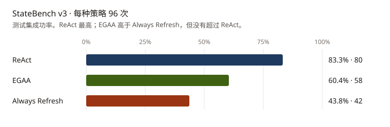
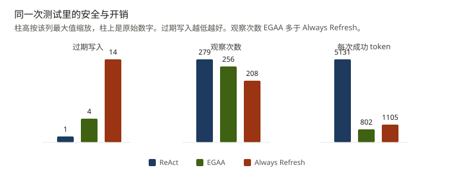
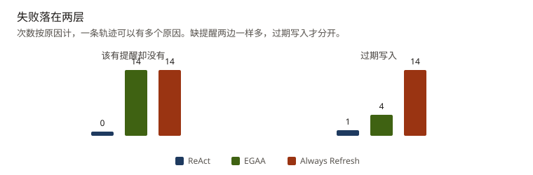
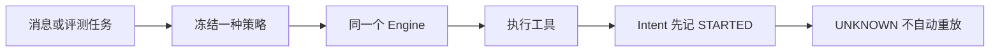

# WhaleAgent

**Evidence-Aware Agent for Multi-Step Workflows**

多步任务里的证据会过期，未知回执也不能再执行一次。WhaleAgent 把 ReAct 和 EGAA 放进同一个 Engine，用同一套工具比较成功率、过期写入、观察次数和 token。

本项目为个人独立设计与实现。模型分数不写进贡献列表。

## StateBench v3

正式测试是 48 条任务 × 3 种策略 × 2 次，共 288 次。模型 `deepseek-flash`，温度 0。每种策略 96 次。开发者复核过题目，`third_party` 为 no，不是第三方盲审。验证集在开跑前按规则选中了 react@1，测试集仍保留三组。



ReAct 成功率最高，过期写入也最少。EGAA 相比 Always Refresh 成功率更高、过期写入更少，但没有超过 ReAct。这不是 EGAA 对 ReAct 的全面升级。

| 策略 | 成功 | 过期写入 | 观察 | 每次成功 token | 耗时合计 |
| --- | ---: | ---: | ---: | ---: | ---: |
| react@1 | 80/96 | 1 | 279 | 5131 | 586.5 秒 |
| egaa@2 | 58/96 | 4 | 256 | 802 | 99.7 秒 |
| Always Refresh | 42/96 | 14 | 208 | 1105 | 98.0 秒 |

耗时是 96 次 `elapsed_ms` 相加，不是平均，也不是分位数。



按蓝图聚类、5000 次、种子 20261110：

- EGAA 减 Always Refresh 的成功率差区间是 [0.042, 0.313]，不含 0。观察差区间是 [0.292, 0.708]，EGAA 观察更多。单次 token 差的区间含 0。每次成功 token 更低，是因为成功数更多，两边的提示 token 都是 31200。
- EGAA 减 ReAct 的成功率差区间是 [-0.417, -0.052]，不含 0，上界低于 5 个百分点。这份样本不支持“EGAA 不差过 5 个百分点”。token 差的区间整个在 0 以下。

原始行在 [evals/statebench/v3/results/test.json](evals/statebench/v3/results/test.json)。区间说明在 [docs/evaluation/v3-statistical-analysis.md](docs/evaluation/v3-statistical-analysis.md)。

## 失败落在哪



两种计划策略各有 14 次“该有提醒却没有”，刷新规则没有把提醒补出来。过期写入是 14 对 4，这一层 EGAA 比 Always Refresh 好。EGAA 的 `value_from` 只能指向一份事实，两份原文要合成一段、或待办不能混入新名字时，整份拷贝就会失败。ReAct 没有这条限制，所以成功率更高，也更贵。归因在 [docs/evaluation/v3-failure-attribution.md](docs/evaluation/v3-failure-attribution.md)。

## 核心设计

一条消息或一道评测题进入同一次 Run。Run 开始时冻结 `react@1` 或 `egaa@2`，之后不再更换。Engine 只调用这一个 Policy。工具执行前先把 Intent 记成 `STARTED`。回执 `UNKNOWN` 时，同一次不可逆写入不再执行。



四个机制就够看首页：

- 草稿可重写，提醒不可逆。写提醒前才要求再核对来源。
- 已经收成 `UNKNOWN` 的事实，不会为了缺证据被反复重读。
- 来源修订对不上就不提交当时看到的旧值。跨系统的剩余竞态记为 `residual_race`，不把它说成强一致。
- 评分在回合结束后看隐藏世界，策略提示里没有变化后的原文。

## 复现

不调用模型：

```bash
python -m evals.statebench.v3.audit
python -m unittest tests.statebench.test_v3_dataset tests.harness.test_fault_matrix -q
python scripts/demo_whaleagent.py
```

已完成的 288 次在 `evals/statebench/v3/results/test.json`。要重跑测试集，需要自己的 API key，并先通过 `frozen_manifest.json` 里的开封标记：

```bash
python -m evals.statebench.v3.live --split test --policies react,egaa,always_refresh --repeats 2
```

## 工程证据

故障注入 200 个情景，重复不可逆效果为 0，剩余竞态 20。这只覆盖预定义种子。记录在 [docs/evaluation/v4-reliability.md](docs/evaluation/v4-reliability.md)。未知回执的轨迹在 [docs/evaluation/recovery-trace.md](docs/evaluation/recovery-trace.md)。

可以写进简历的数字：`react@1` 与 `egaa@2` 在同一个 Engine 上；v3 测试集 80/96、58/96、42/96，以及上面两个不含 0 的区间；故障注入 200 次、重复不可逆效果 0。不能写 EGAA 全面优于 ReAct，不能写它更省观察或更省单次 token，不能写第三方复核通过。

<details>
<summary>v1 / v2 历史实验</summary>

这些数字不是 v3 正式结果。

v2 冻结五题只跑一次，`deepseek-flash`，温度 0。成功数是 ReAct 3/5、EGAA 5/5、Always Refresh 5/5。耗时 25.3 秒、111.4 秒、120.4 秒，是五题相加。EGAA 的 completion 是 18384，其中计划生成 12957。没有置信区间。同一开发集六题上，EGAA 的 completion 高于 Always Refresh，和这五题的方向相反。

v1 是 40 道脚本题、Mock、token 为 0。人工复核仍是 PENDING。B2 和 B3 都是 40/40，工具次数相同，不能说明选择性观察更省。

</details>

<details>
<summary>进一步阅读</summary>

- [docs/evaluation/v3-frozen-report.md](docs/evaluation/v3-frozen-report.md)
- [docs/evaluation/v3-validation-selection.md](docs/evaluation/v3-validation-selection.md)
- [docs/evaluation/v3-dev-results.md](docs/evaluation/v3-dev-results.md)
- [docs/architecture/overview.md](docs/architecture/overview.md)
- [docs/architecture/project-sync-loop.md](docs/architecture/project-sync-loop.md)
- [docs/README.md](docs/README.md)

</details>
