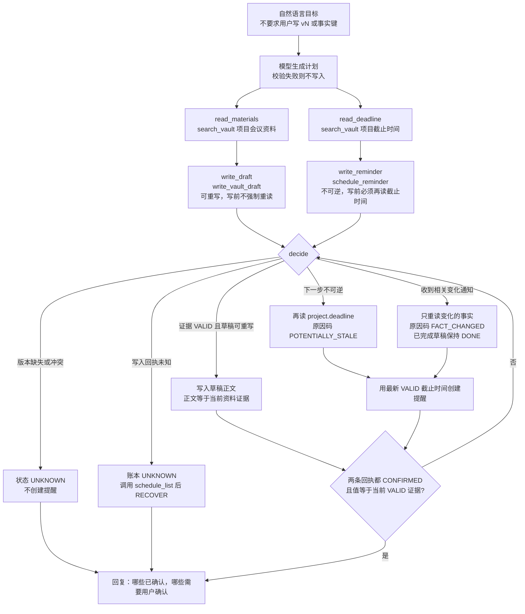

# WhaleAgent

**Evidence-Aware Agent for Multi-Step Workflows**

状态感知的多步任务 Agent。QQ 里给出跨资料、笔记和提醒的目标后，Agent 自己取证并执行工具；资料变化或回执未知时改后续动作。未确认的外部效果不会自动再执行。

本项目为个人独立设计与实现。QQ 是入口，Harness 是可靠执行底座，EGAA 是证据门控决策。三者服务同一条任务。

## 核心贡献

- 同一 `agent.engine` 承载 ReAct 与 EGAA。Policy 在 Run 开始时冻结为 `react@1` 或 `egaa@2`，决策与执行分离。
- Harness 在工具执行前把 Intent 落成 `STARTED`。提醒是不可逆技能；回执 `UNKNOWN` 时同一次决策不再创建，Run 保持 `unknown`。
- 证据门控区分可重写草稿和不可逆提醒。已经读成 `UNKNOWN` 的事实不会为了 `MISSING_EVIDENCE` 被反复重读。

模型分数放在文末的结果里，不放进贡献列表。故障轨迹能复核的范围在 [docs/evaluation/recovery-trace.md](docs/evaluation/recovery-trace.md)。

## 问题与动机

多步任务 Agent 常见四种失败。读一次再写一次，写入时来源已经变了。回执未知被当成失败重放，外部提醒可能发出两次。草稿和不可逆动作用同一套策略，要么过度观察，要么该核对时不核对。

ReAct 把下一步交给单次模型调用。它没有显式证据槽，也分不清「可重写」和「不可逆」。模型可以完成任务，但观察成本和过期写入都不由规则约束。

本项目的切入点是三件事放在同一条执行链上。证据门控决定何时再读。副作用账本决定未知回执能不能重放。同一个 Engine 在 Run 开始时冻结一个 Policy，使 ReAct、EGAA 和 Always Refresh 面对同一套工具与观察语义。

演示目标是：整理项目会议资料，把待办写入 Vault，按最新截止时间创建提醒；信息冲突先核实，结束时说明哪些已确认、哪些还要用户确认。

## 系统流程

一条 QQ 消息变成一次 Run。`start_run` 之后选定 ReAct 或 EGAA，把 `policy_name` 和 `policy_version` 写入这笔 Run，之后只调用这一个 Policy。工具执行、轮次和停止由 Engine 负责。Intent 账本仍由 Harness 负责。

```mermaid
flowchart TD
  subgraph entry ["入口"]
    QQ["QQ 用户"]
    CLI["Coding CLI<br>python -m agent.main"]
    Bench["StateBench<br>离线快照世界"]
  end

  QQ --> NapCat["NapCat / OneBot WebSocket"]
  NapCat --> Channel["channel<br>去重、限流、短句拦截、会话"]
  Channel --> Run["harness.runtime.start_run<br>冻结技能版本和 guardrails<br>生成 Run ID"]

  Run --> Select{"start_run 之后选定一次 Policy"}
  Select -->|"整理或同步资料、会议、截止、提醒、待办或 Vault"| FreezeE["冻结 egaa&#64;2"]
  Select -->|"其它 QQ 消息"| FreezeR["冻结 react&#64;1"]
  FreezeE --> Engine["agent.engine.run_engine<br>重复调用同一个 Policy"]
  FreezeR --> Engine
  CLI --> FreezeC["Coding CLI 使用 react<br>不写 QQ 账本"]
  FreezeC --> Engine

  Engine --> Policy{"本 Run 已冻结的 Policy"}
  Policy -->|"egaa&#64;2"| Egaa["EGAA Policy<br>模型生成计划并抽取原文，decide 控制观察和修复"]
  Egaa --> Decide["algorithms.decide<br>只看信念、计划和已见通知"]
  Decide --> Kind{"Decision.kind"}
  Kind -->|OBSERVE 或继续读取| Exec
  Kind -->|CONTINUE 写入| Exec
  Kind -->|REPLAN| Repair["repair_plan<br>未完成节点重新绑定证据<br>已完成节点保持 DONE"]
  Kind -->|RECOVER 或 STOP| Reply
  Repair --> Engine

  Policy -->|"react&#64;1"| React["ReAct Policy<br>一次 model_step，返回工具或停止"]
  React --> Model["model_step<br>一次推理，返回文本或 tool call"]
  Model -->|有工具调用| Exec["执行器.execute<br>QQ 走 Harness 账本，CLI 不写 QQ 账本"]
  Model -->|无工具调用| Reply

  Exec --> Started["PreToolUse<br>Intent STARTED 先落盘"]
  Started --> Dispatch["dispatch 领域工具<br>Vault / 催办 / 记忆"]
  Dispatch --> Effect{"拿到结果后收口"}
  Effect -->|SUCCEEDED| Obs["Observation<br>事实、source_version、来源 URI"]
  Effect -->|FAILED| Reply
  Effect -->|UNKNOWN| Hold["不自动重放<br>只按本次 operation_id 查 schedule_list"]
  Hold --> Reply
  Obs --> Belief["apply_observation<br>VALID / UNKNOWN / SUPERSEDED / 冲突"]
  Belief --> Decide

  Reply["回复用户"] --> Finish["runtime.finish<br>有 UNKNOWN Intent 时 Run 状态保持 unknown"]
  Finish --> Trace["同一 Run ID<br>runs/run_id.json 的 Intent<br>decisions/run_id.json 的决策原因"]
  Trace --> Console["FastAPI 控制台 /harness/runs/id"]

  Bench --> V1["StateBench v1<br>冻结 Runner，复现旧结果"]
  Bench --> V2["StateBench v2<br>同一个 Engine 和 Policy"]
  V1 --> V1Run["原 Runner<br>B0 脚本 / B1–B4 decide"]
  V2 --> V2Ad["模拟执行适配器<br>不打开 QQ Run"]
  V2Ad --> Engine
  V1Run --> Score["循环结束后评分<br>隐藏真值不进入策略"]
  V2Ad --> Score
```



如果图不渲染，读这段。QQ 经 NapCat 进入 channel，`start_run` 生成 Run 并冻结一个 Policy，然后进入 `agent.engine`。EGAA 只返回继续、观察、修复、恢复或停止；副作用只发生在 `execute_tool`。顺序是先把 Intent 落成 `STARTED`，再 dispatch 领域工具，拿到结果后才收成成功、失败或 `UNKNOWN`。成功的结果写成观察并回到同一个 Policy。失败直接回复。`UNKNOWN` 不把同一次写入再执行一遍；提醒只在 `schedule_list` 里出现这次的 `operation_id` 时才确认，同名提醒不算。Run 结束时，未确认的 Intent 使 Run 保持 `unknown`。同一 Run ID 串起账本和决策原因。StateBench v1 用冻结 Runner 复现旧结果。v2 用同一个 Engine 和模拟执行器，评分在循环结束之后。Coding CLI 走 ReAct，不写 QQ 账本。

读图时抓住五件事：

1. **一次消息选定一次 Policy。** `policy_name` 和 `policy_version` 写入 Run 之后不再更换。Run ID 同时挂上 Intent 账本和决策记录。
2. **决策者不执行工具。** `decide` 返回继续、观察、修复、恢复或停止。副作用只发生在 `execute_tool`。
3. **ReAct 和 EGAA 都不再自己执行工具。** `core.loop.agent_loop` 只是组装 ReAct Policy 后调用 Engine。项目资料任务把模型计划交给 EGAA Policy，再进入同一个 Engine。
4. **UNKNOWN 先落账，再停止。** 超时或工具声明结果未知时，应用层不再发第二次同样的写入。提醒只在查询结果含本次 `operation_id` 时确认，同名任务不算。
5. **v1 和 v2 不是两个执行循环。** v1 保留冻结 Runner，用来复现旧结果。v2 使用同一个 Engine、同一个 Policy 和模拟执行适配器。评分器在循环结束后才读世界真值。

## 项目资料任务的决策环

这条任务有两个分支。草稿可以重写，提醒会造成外部催办。`v` 加整数是唯一可直接比较的版本号。文件 SHA-256 不能排序，但同一来源读到相同哈希时保持原修订，内容变了才登记下一个修订。来源对不上、两份资料冲突，或文本没有来源标识时，不可逆写入停止并请求确认。没有可排序版本，不等于证据永远 `UNKNOWN`。



如果图不渲染，读这段。模型先把自然语言目标收成计划，校验失败则不写入。会议资料支撑可重写草稿，写前不强制重读。截止时间支撑不可逆提醒，写前必须再读。相关事实变化时只重读那一条，已完成草稿保持完成。来源缺失或冲突则不创建提醒。提醒回执未知时查一次已有任务并停止，不把创建再执行一遍。目标核对只看当前 `VALID` 证据和已确认回执。

逐步工具对照在 [docs/architecture/project-sync-loop.md](docs/architecture/project-sync-loop.md)。

## 结果

数字分三层。主结果不能外推成算法优势，也不是正式榜。归因和每成功成本在 [docs/evaluation/v2-failure-attribution.md](docs/evaluation/v2-failure-attribution.md)。超时、回执丢失、同名提醒和重启的轨迹在 [docs/evaluation/recovery-trace.md](docs/evaluation/recovery-trace.md)。

**探索性冻结对照：冻结五题，只跑一次。** 2026-11-10，`deepseek-flash`，温度 0，每题最多 8 轮，观察预算 6。任务在开跑前冻结，校验和在 [evals/statebench/v2_heldout_frozen.json](evals/statebench/v2_heldout_frozen.json)。三种策略看到同一句目标和同一套工具。五题不足以支持稳定推广。没有置信区间，也没有第三方人工复核。表里的耗时是五题墙钟时间相加，不是单题平均，也不是 P50 或 P95。EGAA 的 111.4 秒就是这五题 `elapsed_ms` 之和。

| 策略 | 成功 | 过期提醒 | 读取 | completion tokens | 每成功 completion | 耗时 |
|------|------|----------|------|-------------------|-------------------|------|
| ReAct | 3/5 | 2 | 10 | 2627 | 875.7 | 25.3 秒 |
| EGAA | 5/5 | 0 | 14 | 18384 | 3676.8 | 111.4 秒 |
| Always Refresh | 5/5 | 0 | 18 | 19541 | 3908.2 | 120.4 秒 |

ReAct 在两道截止时间会变化的题上用了旧时间。EGAA 和 Always Refresh 都用了新时间；冲突和缺时间的题都写了草稿，没有创建提醒。这次 EGAA 的读取、completion 和每成功 completion 都少于 Always Refresh，但只是这一次五题的结果。把 prompt 加进去之后，每成功总 token 是 ReAct 4216.3、EGAA 4320.4、Always Refresh 4658.6。EGAA 的 completion 里，计划生成占 12957。稳定题上它仍回读了一次会议资料。

**消融：同一开发集六题。** 修复前的轨迹在 [evals/statebench/v2_live_results.json](evals/statebench/v2_live_results.json)。当时冲突题不要求草稿，EGAA 的宽松成功是 4/6；严格要求草稿后是 3/6。三题卡在同一条未确认读取上，deadline 被连读五次后观察预算耗尽。`egaa@2` 让读节点在一次观察后收口。同一六题再跑，EGAA 和 Always Refresh 的严格成功都是 6/6，过期提醒都是 0；ReAct 仍是 4/6、过期提醒 2。EGAA 读取 16 次，Always Refresh 22 次。EGAA 的 completion 仍是 24360，高于 Always Refresh 的 21616，其中计划生成 17534。每成功 completion 是 ReAct 640.5、EGAA 4060.0、Always Refresh 3602.7。开发集上 EGAA 更贵，冻结五题上这次更便宜，方向相反。这六题被用来发现失败，不能当作独立成绩。记录在 [evals/statebench/v2_dev_after.json](evals/statebench/v2_dev_after.json)。

**支撑证据：StateBench v1 冻结环境。** 40 道题，脚本化配置，Mock，token 为 0。人工语义复核仍是 PENDING。B0 脚本化 ReAct 为 20/40 成功、20/40 过期写入。B2 证据门控与 B3 每次写前刷新都是 40/40 成功、0 过期写入。二者工具次数相同，只能说明写前重读这一机制可复现，不能说明选择性观察更省。成功率差 0.50，区间 [0.30, 0.70]，比较对象是脚本，不是真实模型。全文在 [docs/evaluation/egaa-v1-results.md](docs/evaluation/egaa-v1-results.md)。

**旁证：Coding Harness A–F。** 2026-08-21，`qwen3.7-plus`，离线 17/17、在线 31/31。它检查工具、权限、任务图、MCP 和上下文是否按契约工作。这不是本工作流的成绩，也不是 SWE-bench。汇总见 [evals/SUMMARY.md](evals/SUMMARY.md)。

**StateBench v3。** 48 个蓝图、96 条实例已经能离线审计，覆盖 S0–S5 和四种依赖图。人工复核是 `HUMAN_REVIEW_PENDING`，测试集没有开封，所以没有新的真实模型主表，也没有置信区间。紧凑计划和局部更新有代码和单测，没有开发集费用对照。审计在 [docs/evaluation/v3-dataset-audit.md](docs/evaluation/v3-dataset-audit.md)。

协议与复现：[docs/evaluation/statebench-v2-protocol.md](docs/evaluation/statebench-v2-protocol.md)。

## 3 分钟上手

不连接 QQ，也不读取模型密钥：

```bash
python scripts/demo_whaleagent.py
python -m evals.statebench.v3.audit
python -m unittest tests.application.test_project_sync tests.harness.test_recovery_trace tests.architecture tests.harness.test_executor_port -v
python -m evals.statebench.runner --split dev --mock
```

第一条核对决策闭环和账本。第二条在快照世界里复现 v1 的脚本对照。控制台随 `python -m agent` 启动，需要 `QQ_ADMIN_PORT` 和 NapCat，不在这条离线路径上。

## 技术栈

| 层 | 技术 | 职责 |
|----|------|------|
| 运行时 | Python 3.10+，`contextvars` | 一条消息在一次调用栈里完成决策和工具执行 |
| 模型 | DeepSeek，OpenAI 兼容接口，`httpx` | QQ 对话与计划生成；v1 对照默认不请求模型 |
| 执行 | 自研 Harness：原子 JSON、Intent 账本 | 执行前落盘 `STARTED`，未知回执收成 `UNKNOWN` |
| 决策 | 自研 EGAA：计划图、证据槽、`decide` | 返回继续、观察、修复、恢复或停止；算法包不依赖 QQ 与 Harness |
| 编排 | `agent/engine`，`agent/policies`，`agent/application` | 冻结 Policy，翻译工具，把回执收成观察 |
| 资料 | SQLite，SHA-256，Obsidian Vault，`fastembed` | 检索笔记、落盘草稿、用哈希判断内容是否变化 |
| 催办 | APScheduler + SQLite | 创建和查询本地提醒 |
| 控制台 | FastAPI，itsdangerous Magic Link | 按 Run ID 查看 Intent，并看成功率与 `UNKNOWN` 比例 |
| 评测 | `unittest`，StateBench 快照 | v1 冻结 Runner；v2 复用同一个 Engine |

配置在 `agent/.env`，模板是 `agent/.env.example`。依赖清单是 `requirements.txt`。Coding CLI、RSS、早报、闪念和记账仍保留各自入口，不占这条主线。

## 目录

```text
agent/engine/          唯一步骤循环
agent/policies/        ReAct 与 EGAA，Run 开始时冻结其一
agent/application/     项目资料的工具对照和目标核对
agent/channel/         QQ 适配器，打开 Run 后进入 Engine
agent/harness/         Run、Intent 账本、UNKNOWN、Trace
agent/algorithms/      计划、信念、证据、decide。不执行副作用
evals/statebench/      v1 冻结对照、v2 真实模型记录、v3 未开封数据集
tests/application/     本条主线的行为测试
docs/                  架构、契约、评测、ADR
```

## 本地核对

第一条命令覆盖这些行为：

| 场景 | 期望 |
|------|------|
| 选择性观察 | 证据门控写草稿前不重读资料；每次写前都刷新会多读一次资料 |
| 部分变化 | 截止时间从 v1 变为 v2 后，已完成草稿不重写，提醒使用新时间 |
| 无来源 | 截止时间没有版本、哈希和来源时，不创建提醒 |
| 内容哈希 | 同一来源的相同哈希保持一个修订，可以创建提醒；两个来源值不同则保持未知 |
| 未知回执 | `schedule_reminder` 只出现一次。查询结果含本次 `operation_id` 才确认；同名但另一个 id 保持未知。重启把 `STARTED` 收成 `UNKNOWN`，第二次恢复不再追加通知 |

## 已知限制

EGAA 还没有在 v3 上证明比 Always Refresh 更省，同时保持成功率。v2 开发集和冻结五题的费用方向相反。200 次故障注入只覆盖预定义种子，Vault 和调度器之间仍有剩余竞态。v1 的 40/40 是 Mock，不是真实模型。人工复核没有完成。

可以写进简历的数字只有这些：同一 Engine 上的 `react@1` 与 `egaa@2`；冻结五题一次运行的 3/5、5/5、5/5，以及 EGAA 计划 token 12957/18384；故障注入 200 次、重复不可逆效果 0。不能写稳定优于 Always Refresh，不能写 96 题真实模型成绩。

## 明确不引入

问题是动态环境里的证据是否仍可信、何时值得再观察、未知副作用能否重放。为此不引入 LangGraph、Redis、Kafka、Kubernetes，也不做模型后训练、强化学习、公开基准接入或插件市场。OneBot 异步化单独验收，不拿来比较策略。深度放在证据决策、副作用账本，以及同一 Engine 上的可复现对照。

## 文档

| 文档 | 内容 |
|------|------|
| [docs/architecture/overview.md](docs/architecture/overview.md) | 组件边界 |
| [docs/architecture/runtime-flow.md](docs/architecture/runtime-flow.md) | 一条 QQ 消息的账本顺序 |
| [docs/architecture/project-sync-loop.md](docs/architecture/project-sync-loop.md) | 项目资料任务的逐步决策 |
| [docs/architecture/algorithm-flow.md](docs/architecture/algorithm-flow.md) | 原因码与策略开关 |
| [docs/evaluation/v2-failure-attribution.md](docs/evaluation/v2-failure-attribution.md) | 六题失败归因和冻结五题 |
| [docs/adr/0004-application-driver.md](docs/adr/0004-application-driver.md) | 为什么由应用层把 `decide` 接进 Run |
| [docs/README.md](docs/README.md) | 全部文档索引 |
