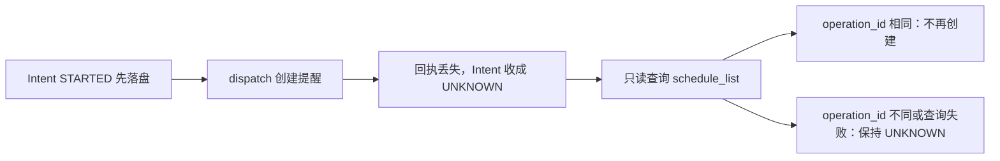

# Harness 故障轨迹

同一条 Run 上，回执丢失后的顺序是：



| 步骤 | 状态 | 这一步做什么 |
|------|------|----------------|
| 1 | STARTED | 工具还没执行，Intent 已经落盘 |
| 2 | dispatch | 只调用一次 `schedule_reminder`，参数里带这次的 `operation_id` |
| 3 | UNKNOWN | 超时或回执丢失。不把这次调用标成成功 |
| 4 | 查询 | `schedule_list` 只认本次 `operation_id` |
| 5 | 确认或停止 | 对上了就不再创建。对不上，或查询失败，就保持 UNKNOWN |

这份材料不调用模型，也不连接 QQ。它记录同一次 Run 里的 Intent、决策和最终状态。行为由下面的测试复核；JSON 是一次本地导出，里面的 Run ID 会变。

```bash
python -m unittest tests.harness.test_recovery_trace -v
```

导出样本：[recovery-trace.example.json](recovery-trace.example.json)。

四条路径都走现有执行口：先 `begin_intent` 把状态落成 `started`，再 dispatch，拿到结果后才收口。`schedule_reminder` 的效果类是 `irreversible`，恢复动作是 `ask_user`。

## 回执丢失，查询里出现同一次操作

`schedule_reminder` 只出现一次。它的 Intent 停在 `unknown`，摘要是 `UNKNOWN: timeout`。随后的 `schedule_list` 成功，正文里的 `operation_id` 等于这次 Intent 的 id。目标核对是 `GOAL_MET`。

频道结束时会调用 `finish(SUCCEEDED)`。只要还有 `unknown` Intent，`finish` 把 Run 收成 `unknown`，不把这次提醒改成成功，也不再创建一次。

## 同名但不是同一次操作

查询结果里有一条标题相同的提醒，`operation_id` 是另一个 id。`schedule_reminder` 仍然只有一次。目标核对是 `UNVERIFIED`，Run 收成 `unknown`。同名不算这次执行的回执。

## 超时

handler 抛出 `TimeoutError`。调用次数是 1。Intent 和 Run 都是 `unknown`，恢复动作是 `ask_user`，错误文本是 `lost receipt`。

## 重启

工具还停在 `started`、Run 仍是 `tool_running` 时换一个 Runtime 读同一份账本。第一次 `recover_open_runs` 把它收成 `unknown`，错误是「执行中断，结果未知」，并留下一条通知：不会自动再做一遍。第二次恢复不再追加通知。

## 这份轨迹没有证明的事

决策里有一次 `POTENTIALLY_STALE`，钩子也看到了对「项目截止时间」的第二次 `search_vault`。参数和上一次相同，幂等账本直接返回已成功的结果，handler 没有再次执行。所以这里不能证明：读取之后、写入之前，资料变了还能被重新观察到。条件写入或 `expected_revision` 还没有做。
