# 逻辑流程

## 消息主路径

```mermaid
flowchart TD
  E[OneBot 事件] --> D{去重/冷却/忙?}
  D -->|丢弃| X[结束]
  D --> G{"群里没有点名?"}
  G -->|是| C[缓存 + 静默入库]
  G -->|点名或私聊| Q[job_queue 入队]
  Q --> F{有附件?}
  F -->|是| IN[ingest 摘要与标签]
  IN --> ACK[元数据回执]
  F -->|否| S[短句拦截]
  S -->|命中| Z[待办/文件/退出等直接回复]
  S -->|未命中| R0[start_run 冻结契约与 guardrails]
  R0 --> W{项目资料协同?}
  W -->|是| FE["冻结 egaa&#64;2"]
  W -->|否| FR["冻结 react&#64;1"]
  FE --> ENG[agent.engine 调用这一个 Policy]
  FR --> ENG
  ENG --> EX[Harness 执行口到 execute_tool：STARTED 落盘后再执行]
  EX --> R[safe_send 引用回复]
  R --> FIN[finish Run]
  FIN --> H[后台 harvest 画像]
```



群里没 @ 的消息不进模型，也不开 Run。短句拦截（待办查询、退出清会话、保存上面的文件、私聊文件列表）在 `channel/intercept.py`，命中后不进 Engine。整理或同步项目资料时冻结 `egaa@2`，其它消息冻结 `react@1`。两种选择都进入 `agent.engine`，同一次 Run 不再更换 Policy。

用户原文里带 URL 时，`run_qq_agent` 会先 `fetch_url` 把正文包进 `<untrusted_content>`，再交给模型。

## 工具与账本

```text
模型发出 tool_call
  → PreToolUse
  → 无契约则拒绝（QQ 路径 require_contract=True）
  → 同参数已成功的幂等/可重试调用：返回上次摘要
  → 不可逆且 guardrails 禁止自动重试、同参数已失败或未知：不再执行
  → 写入 STARTED 并 fsync
  → sandbox none | ast | process
  → SUCCEEDED / FAILED / UNKNOWN
```

进程在 `STARTED` 之后杀掉：下次启动把该意图标成 `UNKNOWN`，下一条相关会话先看到一句确认，不会自动重做。

## 文件资产检索

```text
「把上次那个 PDF 发我」
  → nl_search 解析类型 / 时间
  → search_for_user 按文件名、摘要、标签打分
  → 直发图片或 upload_file
  → 回执带上类型、大小、时间、标签
```

未 @ 时收到的文件只下载、去重、建索引，不调模型写摘要。

## 催办

```text
自然语言建催办 → schedule_reminder
  → SQLite 任务 + 多点 tick
  → APScheduler DateTrigger
  → 到点私聊或群提醒，不再调模型
「导出日历」→ ICS（可导入 Google / Outlook）
```
